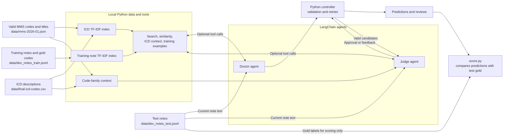
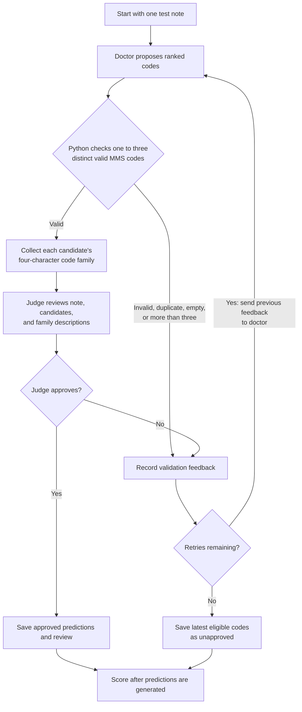

# Test04: Doctor and judge agents

Test04 is a research experiment that predicts up to three ICD-11 MMS codes for
a clinical note, then evaluates them against held-out labels. It is **not for
clinical use**.

The workflow has two LangChain agents: a **doctor** proposes codes and a
**judge** reviews them. Python coordinates their turns, validates codes, manages
retries, saves results, and calls the scorer. The agents have the same local
tools but may choose different tools on each turn.

## Architecture



The test note's **gold label is not passed to either agent**. 

## Per-note agent flow



1. The doctor receives the current note and feedback from previous attempts. It
   aims for three plausible alternatives, ranked best first, but may return
   fewer rather than inventing unsupported codes.
2. Python normalizes the proposals and checks them against the MMS list. Invalid
   or duplicate proposals trigger feedback and a retry **without a judge call**.
3. For each distinct candidate family, Python supplies the judge with entries
   whose code stem has the same first four characters, before the decimal point.
   The context includes MMS titles and available CSV title, definition, and
   text. Related CSV entries outside MMS are marked as ineligible. An MMS code
   remains eligible even if it has no CSV description.
4. The judge approves one to three supported codes or gives feedback. On
   rejection, Python passes that feedback to the doctor for another attempt.
5. By default, there is one initial attempt plus **three retries**. If none is
   approved, Python returns the most recent nonempty set of eligible codes,
   marked `approved: false`. These may be a filtered subset of an invalid
   proposal and may not have been reviewed by the judge. If no eligible codes
   were ever proposed, the returned list is empty.

`complete` means the output contains three codes. It does **not** mean the
judge approved them, and an approved output can contain fewer than three.

## Tools and data

Both agents can call these tools during their own LangChain tool-calling loops.
The prompts encourage tool use, but Python does not require every tool to be
called on every attempt.

| Tool | What it does | Data used |
|---|---|---|
| `search_icd` | Finds MMS codes with matching text; returns eight by default, up to 20. | MMS titles and available CSV titles, definitions, and text |
| `compare_similarity` | Scores the note or query against up to 20 selected MMS codes. | The same ICD index |
| `icd_context` | Returns a code's family entries, descriptions, and MMS-validity flags. | MMS list and ICD CSV |
| `training_examples` | Retrieves similar labeled notes; returns three by default, up to five. | Training-note text and gold codes |

Search and comparison use **TF-IDF cosine similarity** with single words and
two-word phrases. This measures lexical overlap; it is not a medical embedding
or a probability of correctness. A search with no overlap returns no matches.

Training examples are analogies, not facts about the current patient. The model
is **not trained or fine-tuned** on them. The program checks that training and
test IDs and normalized complete texts do not overlap; it does not guarantee
that there are no near-duplicate notes.

## Offline baseline

When `run_mode = 'offline'`, Python directly ranks MMS codes using the local
ICD TF-IDF index. It does not call either agent or use training examples to
rank predictions. No-overlap notes receive an empty prediction list.

If agent mode is selected but `OPENAI_API_KEY` is absent, the program prints a
warning and falls back to the offline baseline. Check the `mode` field in the
review file: the selected agent-mode filenames can contain offline results
after this fallback.

## Running the notebook

1. In a terminal using the notebook's Python environment, install dependencies:

   ```sh
   python -m pip install -r requirements_test04.txt
   ```

2. Open [evaluate_dev_test04.ipynb](./evaluate_dev_test04.ipynb). Run it from
   the project root and choose the intended mode in the configuration cell:

   ```python
   run_mode = 'offline'  # Local baseline, no model calls
   # Or: run_mode = 'agents'
   ```

3. For agent mode, set `OPENAI_API_KEY` in the environment or the project
   `.env` file. Do not put the key in the notebook or commit it.
4. Run the configuration cell and all following cells. The notebook generates
   predictions, runs [score.py](./score.py), and displays per-note results.

The doctor defaults to `OPENAI_MODEL` or `gpt-6-luna`; the judge defaults to the
doctor's model. The notebook's `doctor_model` and `judge_model` variables can
override them. Change [test04_doctor.txt](./prompts/test04_doctor.txt) or
[test04_judge.txt](./prompts/test04_judge.txt) to adjust the role instructions.

### Privacy, cost, and limits

Agent mode sends the current note and agent tool results to OpenAI. Tool results
can include training-note text and gold codes. Confirm that sharing the data is
permitted before running it, and treat review files as potentially sensitive.

`max_model_calls = 5` limits logical model calls **per agent invocation**, not
per note. Tool calls can require additional model calls; with four attempts,
the doctor and judge can together make up to 40 logical model calls per note.
Provider-level retries can add network requests. There is **no dollar or
elapsed-time budget enforcement**, so this experiment is not guaranteed to
meet the assessment's $1 and 60-minute limits.

## Outputs and scoring

Files are written under `out/`:

| Mode | Predictions | Review history | Per-note score |
|---|---|---|---|
| Agents | `dev_predictions_test04.jsonl` | `dev_reviews_test04.jsonl` | `dev_per_note_test04.jsonl` |
| Offline | `dev_predictions_offline_test04.jsonl` | `dev_reviews_offline_test04.jsonl` | `dev_per_note_offline_test04.jsonl` |

Predictions use the scorer's format, for example:

```json
{"id": "example-note", "codes": ["1A00", "1A00.0", "1A00.1"]}
```

Codes in this example illustrate the output shape, not a medical recommendation.
Each completed prediction and review is flushed as the run progresses. Rerunning
a mode overwrites its output files; an error stops the run, leaving completed
rows in the files. Review attempts contain approval status, feedback, tool names,
and logical model-call counts, rather than full model transcripts.

The scorer compares predictions with the test gold labels. For these slice-A
notes, the score is **50 × top-1 accuracy + 25 × top-3 accuracy**, out of 75.
For example, top-1 of 0.8 and top-3 of 0.9 gives 62.5/75. Top-1 checks the
first code; top-3 checks any of the first three.

The 10 test notes have been used in prior experiments. Their score is
exploratory and is not an estimate from a fresh, untouched test set.
